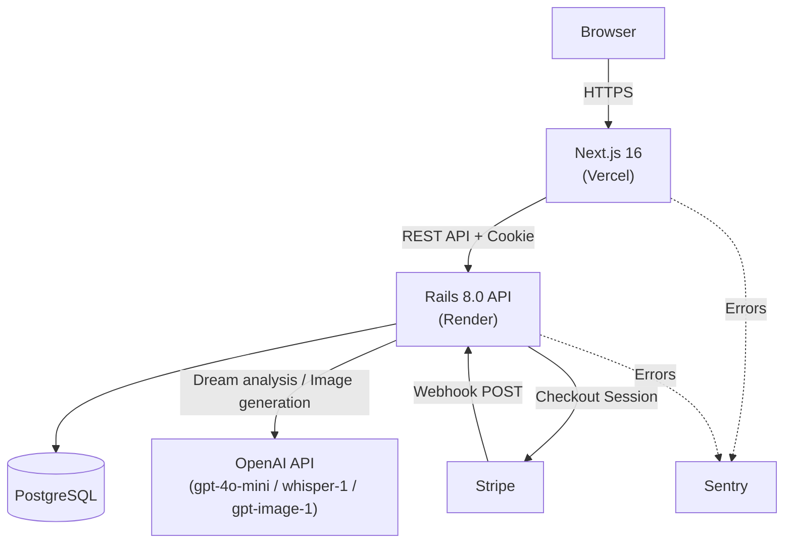

# 🌙 YumeTree — モルペウスと育てるAI夢ノート

**YumeTree（ユメツリー）** は、朝の夢を忘れる前に記録し、モルペウスと一緒に感情や画像で振り返るAI夢ノートです。

夢の内容を記録すると、OpenAI API が分析文と感情タグを返し、日々の夢を単なるメモではなく、自分や大切な人と振り返るきっかけに変えます。

音声入力、AI分析、感情タグ、夢の画像生成を通じて、ひとりでも、家族・恋人・友達とも楽しめるプライベートな夢の記録体験を目指しています。

[](https://github.com/isekaisaru/dreamjournal-app/actions/workflows/e2e-test.yml)
[](https://github.com/isekaisaru/dreamjournal-app/actions/workflows/backend-test.yml)
[](https://github.com/isekaisaru/dreamjournal-app/actions/workflows/frontend-test.yml)

**🌐 公開URL:** https://dreamjournal-app.vercel.app

## 概要

YumeTree（ユメツリー）は、夢の記録・AI 分析・感情タグの可視化・夢の画像生成を組み合わせた、プライベートなAI夢ノートです。
フロントエンドは Next.js 16、バックエンドは Rails 8.0 API を採用し、認証、AI 連携、寄付・月額課金、監視、テストまでを個人開発として、Claude Code・Codex などの AI コーディングツールと協働して構築しています（役割分担は [Author](#author) を参照）。

### 検証状況と既知の制限（2026-11-16 時点）

「実装済み」「CI 成功」「本番で動作確認済み」は区別して管理しています。CI の成功は、外部サービスをモックした範囲を含むため、本番での動作保証とは扱っていません。

| 項目 | 状況 |
|---|---|
| CI（Jest / RSpec / Playwright） | 確認時の `main`（`5e16a566`）は Jest 839 件・RSpec 633 件・Playwright 53 件がすべて成功。E2E は API・Stripe をモックしたシナリオ。ESLint と、テストコードの型検査は CI に未導入（アプリ本体の型は `next build` で検査） |
| Stripe 決済（寄付・月額課金） | 実装済み・過去に本番での決済記録あり。現行コードに対する test-mode の通し QA は未完了。Stripe SDK の 20 系は、Checkout の `payment_method_types` 廃止で寄付が失敗するため見送り中（[#535](https://github.com/isekaisaru/dreamjournal-app/pull/535) に理由を記録。CI は Stripe をモックするため成功していた） |
| 料金プランと利用上限 | 画像生成はプレミアム限定（[#578](https://github.com/isekaisaru/dreamjournal-app/pull/578)）、音声記録は無料プランで月 5 回まで（[#579](https://github.com/isekaisaru/dreamjournal-app/pull/579)）。案内文と実際の制限の食い違いを直した（[#580](https://github.com/isekaisaru/dreamjournal-app/pull/580)）。本番画面での表示確認は未確認 |
| 夢詳細画面の非同期競合（素早い夢の切り替え時の更新・削除） | 古い通信結果の画面反映を防ぐ修正（[#558](https://github.com/isekaisaru/dreamjournal-app/pull/558)）、古い版からの保存を拒否する処理と分析中の編集保護（[#566](https://github.com/isekaisaru/dreamjournal-app/pull/566)・[#567](https://github.com/isekaisaru/dreamjournal-app/pull/567)・[#569](https://github.com/isekaisaru/dreamjournal-app/pull/569)）は `main` にマージ済み。古い版からの保存の拒否は本番の 2 タブ操作で確認済み。音声経路の本番確認と、残りの対応（[#561](https://github.com/isekaisaru/dreamjournal-app/issues/561)）は未完了 |
| 音声記録の再送時の重複登録 | 応答不明時に再送すると重複し得る既知リスク。再送 UI・注意喚起の [#542](https://github.com/isekaisaru/dreamjournal-app/pull/542) は未マージで、サーバー側の重複防止は設計案（[#545](https://github.com/isekaisaru/dreamjournal-app/pull/545)）の段階 |
| Sentry に送るデータの機密保護 | フロントの許可リストによる送信前処理（[#564](https://github.com/isekaisaru/dreamjournal-app/pull/564)・[#565](https://github.com/isekaisaru/dreamjournal-app/pull/565)）と、バックエンドの保護（[#563](https://github.com/isekaisaru/dreamjournal-app/pull/563)：再設定トークン・SQL 内の値・DB 例外の本文を送らない）は `main` にマージ済み。sentry-ruby 7.2 への更新時に、保護を通らないログ・メトリクスの送信を止めた（[#585](https://github.com/isekaisaru/dreamjournal-app/pull/585)）。フロントは本番で確認済み。バックエンドの本番イベントでの確認は未確認 |
| Rails の脆弱性対応 | Rails 8.0.5.2 へ更新済み（[#577](https://github.com/isekaisaru/dreamjournal-app/pull/577)）。7.2 系で修正版が無かった時期の暫定策（Active Storage の analyzers 無効化と `/cable` の停止、[#575](https://github.com/isekaisaru/dreamjournal-app/pull/575)）は継続中。更新後の本番確認（ログイン・保存・分析・音声）は未確認 |
| 特定商取引法に基づく表記・問い合わせ先 | 表記ページは未公開（下書き [#581](https://github.com/isekaisaru/dreamjournal-app/pull/581)）。利用規約とプライバシーポリシーの問い合わせ先は仮のアドレスのまま |
| 夢の森のスマホ実機表示 | ドラッグ時のエラー修正（[#557](https://github.com/isekaisaru/dreamjournal-app/pull/557)）は実機確認待ちで未マージ |
| 本番環境と `main` の一致 | デプロイ中のバージョンと `main` の照合は未確認 |

技術選定では「モダンだから」ではなく、ひとりでも、大切な人とも迷わず使える UX と、継続運用しやすい構成になるかを重視しています。

---

## 1. 解決する課題とプロダクト体験

### 夢の記録と AI 分析

子どもでも扱いやすく、大人も迷わず使えるよう、ひらがなを多めに使った表現やシンプルな入力導線を意識しています。
記録した夢は OpenAI API（デフォルト `gpt-4o-mini`）で分析し、短い解釈文と感情タグを返します。使用モデルは `OPENAI_CHAT_MODEL` 環境変数で切り替え可能な設計にしており、本番挙動を変えずにコスト・品質の比較検証ができます。日々の夢を単なるメモで終わらせず、自分のセルフケアや、大切な人との会話のきっかけに変えることを狙っています。

### 音声入力による夢の記録

Whisper API を使った音声録音→テキスト変換→分析の一連フローを実装しています。
「朝起きたばかりで文字を打つのが面倒」という場面に対応し、録音ボタン一つで夢を記録できます。
文字起こしと分析で費用がかかるため、無料プランは月 5 回まで（残り回数を画面に表示）、プレミアムは月の上限なし（短時間の連続利用には別にレート制限あり）にしています。

### gpt-image-1 による夢のビジュアル化

夢の内容や AI 分析結果をもとに OpenAI の画像生成モデル（gpt-image-1）で画像を生成し、夢の世界をビジュアルで表現できます。
1 枚あたりの費用が大きいため、プレミアム会員だけの機能にしています（`require_premium_for_image`）。月次 31 枚上限（`check_monthly_image_limit`）でコストを管理し、Rack::Attack による追加のレート制限も設けています。
2026 年 5 月廃止予定だった dall-e-3 から gpt-image-1 へ移行済みで、`b64_json` レスポンスを直接 DB に保存することで期限切れ URL の問題を解消しています。

### 月次サマリーと統計

月別アーカイブページでは、その月の記録数・記録日数・感情 Top 3 などの統計をまとめて表示します。
連続記録のストリークバッジも用意し、日々の記録継続を楽しめる仕組みを取り入れています。

さらに「きもちインサイト」ダッシュボード（`/insights`）では、今月の振り返りを 1 ページに集約しています。KPI・ムードカレンダー（各日を最頻感情色で塗るヒートマップ）・モルペウスの月まとめ・きもち TOP5・半年分の記録トレンドを、追加の API を増やさずクライアント側の集計で表示します。

### 夢の森と今週のゆめニュース

記録を「続けたくなる」体験にするため、夢を残すたびに木が育つ「夢の森」を用意しています。プロフィール（自分・家族など）ごとの森を俯瞰でき、収穫演出やモルペウスの案内で、記録の継続そのものが小さな達成になるよう設計しています。

ホームには「今週のゆめニュース」ウィジェットを配置し、直近 7 日間の夢をプロフィールごとに要約します。新しい API を追加せず、ホームが既に取得済みの夢・プロフィールデータをその場で集計する軽量な実装にしています。

### 認証・寄付・月額課金

認証は JWT を HttpOnly Cookie で扱い、フロントエンドとバックエンドを分離した構成でも安全にセッションを維持できるようにしています。

決済は2種類の Stripe フローを実装しています（検証状況は上の「検証状況と既知の制限」を参照）。

- **寄付（一回払い）**: Stripe Checkout → `checkout.session.completed` Webhook → Payment 永続化
- **プレミアム月額課金**: Stripe Subscription → Webhook（`checkout.session.completed` / `invoice.payment_succeeded` / `customer.subscription.deleted` など）→ Subscription の状態を保存し、有効な契約の有無から premium を判定
- **Stripe Billing Portal**: 解約・カード変更・請求履歴をホスト型ポータルに委譲し、PCI 対応の負担なく会員管理を実現

---

## 2. システムアーキテクチャと技術選定



### この構成を選んだ理由

- **フロントエンド: Next.js (App Router)**
  毎日使うアプリとして、初期表示の軽さと操作感の両立を重視しました。Server / Client Components を使い分けつつ、インタラクティブな UI は Framer Motion で補っています。
- **バックエンド: Rails API**
  認証、AI 連携、決済、Webhook 処理のようなドメインロジックを、短いサイクルで安全に改善しやすい構成として採用しました。RSpec による回帰確認もしやすい点を重視しています。
- **認証設計: JWT + HttpOnly Cookie**
  XSS 耐性を意識し、トークンをブラウザの JavaScript から直接触らせない構成にしています。クロスドメイン環境では Vercel 側の API 経由で Cookie を安定して扱えるようにしています。
- **インフラ: Vercel / Render**
  インフラ運用を過度に抱えず、機能改善と UX 検証に集中しやすいフルマネージド構成を選びました。

---

## 3. 設計・実装上の工夫

### ① 利用者フィードバック前提の UX 改善

「ひらがな中心の表示」「夢詳細の閲覧モードと編集モードの分離」「パスワード可視化トグル」「ライト / ダークモード切り替え」など、使いながら分かりにくかった点を小さく改善してきました。

- **パスワード強度バー**: 登録フォームに 弱い / 普通 / 強い の3段階インジケーターを追加。英字・数字・記号の組み合わせと文字数に応じてリアルタイムでフィードバックし、入力ミスを事前に防ぎます。
- **Trial UX 改善**: トライアルページに「残りAI分析: ○回」バッジを常時表示し、上限到達時は登録を促すアップグレードカードを表示。ユーザーが価値を体験してから自然に登録に進める導線を整えました。
- **モバイル / デスクトップ両対応のナビゲーション**: スマホでは親指で届く `BottomTabBar`（ホーム / きもち / 記録 / もり / 設定）、デスクトップでは常駐サイドバーと `⌘K` コマンドパレットを提供し、画面移動や最近の夢へのアクセスを各デバイスに適した操作で行えるようにしています。ランディングページも 2 カラムのデスクトップ向けレイアウトへ刷新しました。

個人開発でも変更を積み重ねやすいよう、Jest・RSpec・Playwright を併用して回帰確認しやすい状態を保っています。

### ② ガイドキャラクター「モルペウス」による画面統一

夢の番人キャラクター「モルペウス」を全11画面にそれぞれ配置し、アプリ全体のトーンを統一しています。
`MorpheusImage` コンポーネントがバリアント（`home` / `analysis` / `login` など）に応じた画像を切り替え、画像読み込みエラー時は SVG フォールバックで表示を保証します。
variant 変更時にエラー状態を `useEffect` でリセットすることで、画面遷移をまたいだ状態リークも防いでいます。

### ③ Value-First Onboarding — ログイン前でもアプリ体験を提供

未ログインユーザーを即座に `/login` へリダイレクトするのではなく、ページ自身が `MorpheusLoginRequired` コンポーネントでやさしく案内する設計にしています。
バックエンドの API 認証は維持したままフロントの導線を緩和することで、新規ユーザーがアプリの価値を感じてからアカウント登録できる流れを作っています。

さらに `/trial` ページでは、アカウント登録なしに AI 分析を最大3回体験できるトライアルフローを提供しています。初回のボタン押下時にバックエンドでトライアルアカウントを自動生成し、分析結果をその場で確認できます。残り分析回数のカウントダウン表示と、上限到達時のアップグレード誘導カードを組み合わせることで、「体験 → 価値実感 → 登録」の自然な流れを設計しています。

### ④ 多対多リレーションとレガシーデータ共存

夢と感情の関係は多対多で表現しています。さらに、AI 分析結果の保存形式が変わった後も既存データを壊さず扱えるよう、表示側で新旧フォーマットを吸収する実装にしています。

### ⑤ dream_profiles による家族・大切な人ごとの夢記録

`dream_profiles` により、「自分」「子ども」「家族」「ペット」など、誰の夢かを分けて記録できるようにしています。
既存ユーザーには self プロフィールを補完し、「自分」プロフィールはアーカイブ不可にすることで、既存の夢データの基準が失われないようにしました。

この機能では、モデル・API・フロントエンドUIの実装に加えて、本番DB migration、既存ユーザー補完、本番ブラウザでの `/profiles` 動作確認、一時的な補完処理の撤去まで行いました。
さらに Supabase Security Advisor の `rls_disabled_in_public` 警告に対応し、フロントエンドから Supabase へ直接アクセスしていない構成を確認した上で、`public.dream_profiles` の Row Level Security を有効化しました。policy なしの Default Deny 方針により、Rails API という正規ルートは維持しつつ、Supabase の直接アクセス口を閉じています。

### ⑥ 監視・セキュリティ・レート制限を後回しにしない

Sentry をフロントエンドとバックエンドの両方に導入し、本番での例外や不安定な挙動を検知しやすくしています。
加えて、CORS 設定、HttpOnly Cookie、環境変数管理のほか、Rack::Attack によるレート制限（登録・分析 API・画像生成を個別に制御）を整備しています。
パスワードポリシーはバックエンドのモデルバリデーションとフロントの入力チェックを一致させ、「8文字以上・英字と数字を各1文字以上含む」を二重に保証しています。登録フォームには3段階の強度バーをリアルタイム表示し、入力中にポリシー充足状況を視覚的にフィードバックします。

**認証基盤の強化（2026年7月）**: 当初は 1 ユーザーにつき平文リフレッシュトークン 1 本という構成でしたが、以下のように多端末・漏洩耐性を意識した設計へ作り直しました。

- **セッションの永続化とトークンの digest 化**: `user_sessions` テーブルを新設し、リフレッシュトークンは SHA-256 digest のみを保存。有効期限・失効時刻・端末情報（`user_agent` / `ip_address` / `last_used_at`）を持たせ、複数端末でのログイン維持とセッション単位の失効に対応します。ログアウト時は該当セッションのみを失効します。旧 `users.refresh_token`（平文カラム）は、既存ログインを切らさないための一時的な互換経路として残し、使用時に消去する移行方式にしています。
- **メールアドレス有効化**: 登録後に確認メールのトークン（同じく digest 保存）でメールアドレスを検証するフローを追加。未確認ユーザーにはホームで `EmailVerificationBanner` を表示し、再送・確認導線を案内します。
- **パスワードリセットトークンの digest 化**: リセットトークンも平文保存をやめ、`reset_password_token_digest` として保存する方式に統一しました。

### ⑦ Stripe 決済フローの堅牢化

寄付（一回払い）と月額サブスクリプションの2フローを実装しています。過去に本番での決済記録がありますが、現行コードに対する test-mode の通し QA は未完了です。

共通の設計方針として、`ensure_stripe_customer_id!` による顧客再利用、Webhook 署名検証（`STRIPE_WEBHOOK_SECRET`）、`ProcessedWebhookEvent` による重複イベント排除、`PaymentsObservability` による構造化ログを整備しています。

Subscription フローでは `client_reference_id` → `stripe_customer_id` → `email` の3段階フォールバックでユーザーを解決し、解約時には `customer.subscription.deleted` を受けて Subscription の状態を更新し、有効な契約が残っていない場合に premium を外す設計にしています。
一次切り分け用に [`docs/runbook-payments.md`](docs/runbook-payments.md) も用意し、機能実装だけでなく運用時の対応手順まで残しています。

### ⑧ 日時処理の一元化とバグ予防

日本時間（JST）での日付処理を `lib/date.ts` に集約し、`toLocaleString("ja-JP")` が返す「2026年」のような日本語文字列が URL パラメータに混入するバグを防いでいます。
`en-CA` ロケールで `YYYY-MM-DD` 形式を取得し、`.slice(0,7)` で月キーを生成することで、Vercel（UTC 環境）でも JST 基準の月グループが正確に機能します。

### ⑨ エラー監視へ送るデータを最小にする

Sentry の `send_default_pii = false` だけでは、パスワード再設定のトークン（URL のパス・Referer・ジョブの引数）や、SQL に埋め込まれた検索語、DB 例外の本文が送られることを、監査で確認しました。
そこで、フロントは許可した項目だけを送る方式に、バックエンドは `before_send` / `before_send_transaction` でトークンと SQL 内の値を取り除く方式にしています（`backend/lib/sentry_event_scrubber.rb`・`backend/lib/sentry_job_arguments_filter.rb`）。保護の処理が失敗したときは、未処理のイベントを送らずに捨てます。
sentry-ruby 7 では、この保護を通らないログ・メトリクスが既定で送られるようになったため、更新と同時に送信を止め、設定を回帰テストで固定しました。

### ⑩ 依存関係の更新を「CI の成功」だけで判断しない

Dependabot の更新は、変更履歴と自分のコードを照合してから判断しています。

- **Stripe SDK 20 系**: CI はすべて成功していましたが、固定の API バージョンが変わり、寄付の Checkout で使っている `payment_method_types` が廃止されることを変更履歴で確認しました。テストは Stripe をモックしているため検知できません。マージせずに閉じ、test-mode の通し QA と合わせて対応する方針にしました（[#535](https://github.com/isekaisaru/dreamjournal-app/pull/535)）。
- **Rails 7.2 → 8.0**: 7.2 系に修正版が無い脆弱性に対し、まず影響する入口を止める暫定策を入れ（[#575](https://github.com/isekaisaru/dreamjournal-app/pull/575)）、そのあと 8.0 へ更新しました（[#577](https://github.com/isekaisaru/dreamjournal-app/pull/577)）。

### ⑪ 費用と継続を数える仕組み

月ごとの AI 利用回数（プラン別）・概算の費用・記録の継続状況を、個人を特定できる値を出さずに集計する読み取り専用のコマンドを用意しています（`bin/rails "usage:report[YYYY-MM]"`、[`docs/usage-report.md`](docs/usage-report.md)）。料金プランと利用上限を、推測ではなく実際の利用量から見直すためのものです。

---

## 4. 開発の記録（技術記事）

実装の背景・設計判断・はまりポイントを Zenn にまとめています。

- 📝 [個人開発で Stripe Webhook を本番稼働させた全記録 — 署名検証・冪等性・3段階ユーザー解決](https://zenn.dev/isekaisaru/articles/2e4860a296799b)
- 📝 [個人開発で gpt-image-1 の 502 エラーを直した記録 — タイムアウト3層設計の全容](https://zenn.dev/isekaisaru/articles/656e5186401467)

---

## 5. 今後の展望・課題

新しい機能を増やすより先に、「確かめる → 数える → 届ける」の順で進めています。

- **確かめる**: Stripe test-mode での通し QA（登録 → 支払い → プレミアム → 解約）、特定商取引法に基づく表記ページの公開、Stripe SDK の更新
- **数える**: 月次の利用レポートと OpenAI の実額から、1 回あたりの費用と採算の合う人数を出す
- **届ける**: 少人数に使ってもらい、何日続いたか・どこで止まったかを記録して、続けるかどうかを判断する
- **品質**: ESLint とテストコードの型検査を CI に入れる。音声記録の再送時の重複防止
- **あとで**: OpenAI モデルの比較検証（`OPENAI_CHAT_MODEL` 環境変数で切り替え可能）、INP の計測と改善、N+1 の解消

---

## Tech Stack & Project Info

<details>
<summary>利用技術</summary>

- **Frontend**: Next.js 16, React 19, TypeScript, Tailwind CSS, Framer Motion
- **Backend**: Ruby on Rails 8.0 (API mode), Ruby 3.3, PostgreSQL
- **Testing**: Playwright, RSpec, Jest
- **AI / External Services**: OpenAI API (`gpt-4o-mini`, `whisper-1`, `gpt-image-1`), Stripe Checkout / Subscription / Billing Portal, Sentry
- **Security**: Rack::Attack (rate limiting), JWT + HttpOnly Cookie, CORS
- **DevOps**: Vercel, Render, Docker Compose, GitHub Actions
</details>

<details>
<summary>ローカル開発環境の立ち上げ</summary>

```bash
git clone https://github.com/isekaisaru/dreamjournal-app.git
cd dreamjournal-app
cp backend/.env.example backend/.env
make dev-up
```

| Service | URL |
|---|---|
| Frontend | http://localhost:3000 |
| Backend API | http://localhost:3001 |
| PostgreSQL | localhost:5432 |
</details>

<details>
<summary>CI/CD</summary>

GitHub Actions で `main` への Push / PR 時に、次の 4 つを実行します。

| ワークフロー | 内容（2026-11-16 の `main` での件数） |
|---|---|
| Frontend Tests | Jest 839 件（82 ファイル） |
| Backend Tests | RSpec 633 件。あわせて `structure.sql` の再生成結果と RLS の状態を照合 |
| E2E Tests | Playwright 53 件（本番ビルドに対して実行） |
| Backend Docker Security | Docker イメージをビルドし、秘密情報が含まれないことを確認 |

**Playwright E2E カバレッジ（CI 実行分）**

CI（GitHub Actions）では、API をモックしたシナリオを自動実行しています。

| シナリオファイル | カバー内容 |
|---|---|
| `smoke.spec.ts` | アプリ起動・ログインリンク表示 |
| `donation.spec.ts` | 寄付フロー・Stripe Checkout 遷移 |
| `checkout-email-gate.spec.ts` | メール未確認のときの決済ガード（寄付・プレミアム）と案内表示 |
| `dream-detail-flow.spec.ts` | 夢詳細表示・編集モード切り替え |
| `registration-flow.spec.ts` | パスワード強度バー（弱い/普通/強い）・バリデーション・登録成功→`/home` 遷移 |
| `trial-flow.spec.ts` | 残り分析回数バッジ・AI分析成功・上限到達時のアップグレードカード表示 |
| `email-verification-flow.spec.ts` | メール確認リンク（トークンなし・期限切れ・成功）と再送の案内 |
| `password-reset-flow.spec.ts` | パスワード再設定フォームの入力チェック・送信中表示・成功／失敗時の表示 |

ホーム・月次サマリー・夢の森・プロフィール・ログアウトのシナリオ（`home-flow.spec.ts` など 5 ファイル）は、CI では実行しておらず、ローカル環境で実行します。
</details>

---

## Author

**Tyougorou**
物流・現場マネジメント経験を経て、手触りのあるソフトウェアで課題解決を行うため Web 開発技術を学んでいます。

YumeTree は Claude Code・Codex を活用して開発している個人プロダクトです。私は課題発見・要件整理・優先順位の決定、AI への実装依頼、結果の確認、作業を進めるか止めるかの判断を担当し、AI は調査・実装・テスト作成・レビューを支援しています。実装・テスト成功・`main` へのマージ・本番での動作確認を分けて記録し、未確認のものは完了として扱わない運用にしています。コードの理解と自力での実装力は、別の小規模アプリや Ruby の演習で継続して鍛えています。
